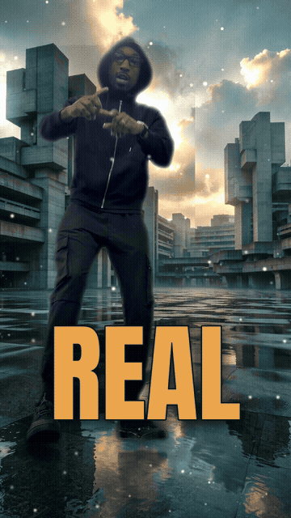
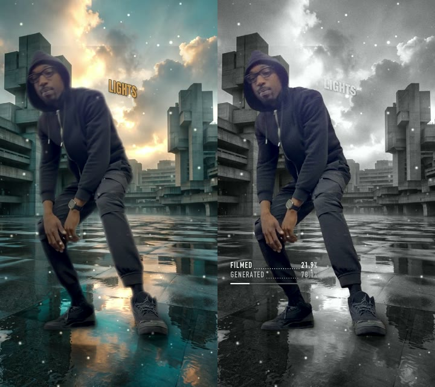
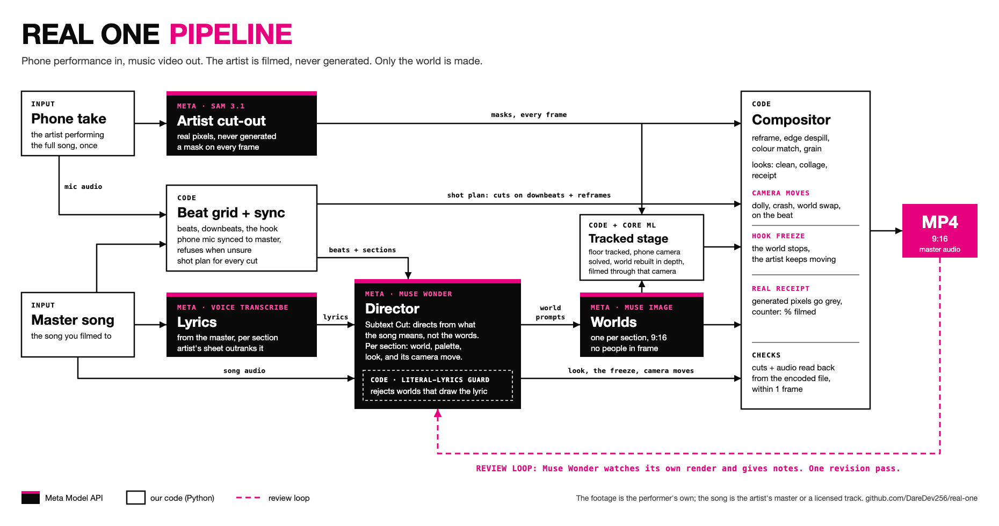

# Real One

**On the hook, the world freezes and only you keep moving.**

Film your song on your phone, once. Real One turns the take into a music video: you stay real, pixel for pixel, and
only the world around you is made, one world for each section of the song, every cut on a downbeat.

<p>


</p>

*Stand-in: a stock clip (Mixkit, free license) and the repo's synthetic test song, through the real pipeline. SAM 3.1
cut the performer out, Muse Image built the world from Muse Wonder's world prompt, and the tracked stage filmed it
through the clip's own camera. Both images are regenerated from the artist's own take once it is filmed
(`scripts/readme_media.py`).*

[How the director works](docs/director.md) · [Implementation notes](docs/implementation-notes.md) ·
[Watch page](web/) · [Build status](docs/status.md) · [Changelog](CHANGELOG.md)

Built for the Meta Global AI Developer Hackathon (Cerebral Valley), Oct 27 to Nov 4, 2026. Everything in this repo
was written during the event window.

## Why

Independent artists rarely have a video budget. AI video tools cut the cost, but they tend to generate the artist's
face or illustrate the lyrics word for word. Real One never generates the artist. Every pixel of you comes from your own
take, and the Real Receipt proves it frame by frame: switch it on and everything the models made turns grey while
you stay in colour.

<p></p>

## How it uses Meta's models

| Model | Its job in Real One |
|---|---|
| **SAM 3.1** | Cuts the artist out of every frame of the take (masks streamed over the Responses API). The same masks are the ground truth for the Real Receipt counter. |
| **Muse Wonder** | Hears the song as audio, reads the lyrics and the beat grid, and writes a treatment per section from what the song means, not what the words say. Then watches its own render as video and gives notes for one revision pass. |
| **Muse Image** | Builds one vertical world per section from the director's world prompt. |
| **Muse Voice Transcribe** | Lyrics from the master, placed by section; the artist's own lyric sheet outranks it. |
| **Muse Spark Open** (Baseten) | Wired, not yet run: an open-weight brain that writes the same song's treatment through the same guard, so two directors can be compared side by side (`plan --brain spark-open`). Tested offline against fixture responses only; it has never run with a key. |

Every path is tested offline against the documented API shapes, and four of the five have run with a key: SAM 3.1
and Muse Image (2026-10-30), then Muse Wonder and Voice Transcribe (2026-11-01: a treatment, and the director's whole
loop, render, watch, revise, re-render, on a stand-in clip). Muse Glimmer and Spark Open are wired, not yet run.

## What it does

- **Beat grid and sections** from the master; the hook is the loudest repeated section.
- **Sync** of the phone's own mic to the master, refusing a weak or ambiguous match instead of guessing.
- **Cuts on downbeats** with wide, medium and close reframes; close-ups come from the phone's native 4K frame; iPhone
  HDR clips are tone-mapped and turned upright.
- **Tracked stage** (`--stage tracked`, [how it works](docs/stage.md)): the floor you stood on is tracked, the phone's
  camera is solved from it, and each world is rebuilt in depth (Depth Anything V2 on the Mac's Neural Engine) and
  filmed through that same camera. Your feet stay planted: floor slip near the feet drops from 6.3 to 0.4 px a frame
  against a still world. A contact shadow cast from the world's own sun, depth of field matched to the take's, and a
  grade from the light around you finish it.
- **A living world** (on by default): the world's lamps and neon flicker, swell on the kick and stutter out on some
  bars, and haze drifts through their light, all on the world's clock (a Hook Freeze freezes them too).
- **Lyrics in the world** (on by default when there is a lyric; `--no-lyrics` turns them off): each phrase of the lyric stands on its own sign in the scene, beside
  you and turned at an angle, tracked to the phone's camera like the floor; you are in front of it because it is
  part of the world layer. With `--word-times` each word lands when it is sung: `scripts/align_lyrics.py` isolates
  the vocal with Demucs and places the artist's own words on it with MMS forced alignment (both Meta, open weights;
  190 of 214 words within a median 48 ms of an independent transcriber on song B). Without it, a word lands on each
  beat, which runs ahead of a fast verse. A blind editor
  critic scored it 5.5/10 against viral lyric clips and 5/10 for reading as 3D (from 4 and 2 a round earlier); the
  words are readable about 60% of the time on the stand-in, where the performer's arms often cross them.
- **Hits on the beat** (`--hits`): every downbeat punches the frame (a zoom kick and an exposure kick), the snare
  beats a smaller kick, harder with a jolt on the hook.
- **Lyric moments** (`--moments`): Muse Wonder reads the lyric and picks two or three words a section for a visual
  hit on the beat they are sung: **ignite** (embers rise behind you and the world takes the heat) or **slam** (the
  word slams in front of you). Never a word about violence, and never drawn on the Real Receipt.
- **Camera moves on the beat** (`--move`): a **dolly zoom** on the hook drop (the world stretches behind you while
  you keep your size, because the stage knows the world's depth and the phone's camera), a **crash zoom** toward
  your face on every downbeat, and a **world swap** every bar with the floor locked under your feet. All of them
  run on Meta's worlds and your own filmed pixels.
- **Hook Freeze**: on the hook's downbeat, rain at three depths hangs mid-air, the camera keeps sliding through it, the
  world drains cool and the artist keeps performing in full colour. The same world falls, hangs and resumes.
- **Real Receipt**: the filmed share of every frame, measured from the masks; `--receipt-reveal` flips a section to
  the receipt look and `--receipt-counter` puts the number on screen.
- **Subtext Cut**: the director's rule, enforced in code by a literal-lyrics guard that rejects any world that just
  draws its own line.

## For judges

- **Watch first:** the 3-minute demo video. [PENDING: link once the video is cut from the artist's real take]
- **Open now:** [real-one-watch.vercel.app](https://real-one-watch.vercel.app), the watch page. Play the cut, toggle
  the Real Receipt (generated pixels go grey, the filmed artist stays in colour, with the filmed share per frame),
  and read the director watching its own cut: Muse Wonder's notes with timestamps, verbatim, and the one change it
  made. Until the artist's take is filmed it runs on a stand-in (a stock clip and a synthetic song), and says so.
- **What was built during the event:** everything in this repo. The repo was created on Oct 28 2026, inside the
  event window, and the git history is the record.
- **Run it with no key** (macOS, Python 3.12+, ffmpeg): `pip install -r requirements.txt`, then
  `python -m realone render --clip <your take> --song <your master> --section hook --mask local --local-plate
  --tag try`. That is a TEST render: Apple Vision masks and code-drawn worlds, no Meta model. A keyed run swaps
  in SAM 3.1, Muse Image and the Muse Wonder director (`MODEL_API_KEY`).
- **What a keyed 3-minute song costs** (the director's own pre-spend quote, `realone/director/budget.py`):
  about US$2.11 expected and US$3.34 at most. SAM 3.1 on every frame is US$1.08 of that; 11 Muse Image worlds are
  US$0.09; the Wonder treatment plus its watch-and-revise loop is the rest. Every run refuses before spending past
  its cap.

## Licenses

MIT (LICENSE), except `realone/samcodec.py`, a compiled port of Meta's SAM 3.1 mask codec, which is distributed
under the SAM License (LICENSES/SAM-LICENSE.txt).

## Engineering

- 247 tests (collected 2026-11-01). Each guard was also broken on purpose to prove its test goes red, then restored byte-identical; the
  log is in `docs/implementation-notes.md` and the CHANGELOG.
- Every render reads its own output back: cuts within 1 frame of the plan, audio within 1 frame of the master, and the
  freeze proven by hashing the world state. A failed check exits non-zero.
- Every paid call is quoted in US$ and CA$ first and capped (`--max-usd`). The take is uploaded once per run and
  expires on Meta's side after a day.

## Run it

```
.venv/bin/pip install -r requirements.txt
export MODEL_API_KEY=...   # lives outside the repo; without it only the TEST_LOCAL path runs
.venv/bin/python -m realone render --clip footage/take1.mov --song footage/master.wav --section hook \
    --look collage --world "rain-soaked Toronto alley at night" --world "rooftop at dusk" --world "empty stage"

# the whole song, a world list per section, Hook Freeze on every hook, the last hook revealed as a receipt
.venv/bin/python -m realone render --clip footage/take1.mov --song footage/master.wav --section all \
    --look collage,receipt --worlds-json worlds.json --freeze hook --receipt-reveal hook:last --receipt-counter
```

Flags: `--section hook|verse|hook:2|bars:A-B|#i|all`, `--look clean|collage|receipt|all` or a comma list,
`--cut-bars 1|2|4|8`, `--mask sam|local`, `--freeze [SECTION]`, `--freeze-bars N`, `--freeze-style bullet|still`,
`--worlds-json FILE`, `--section-world KEY=PROMPT`, `--receipt-reveal SECTION`, `--receipt-counter`,
`--sam-prompt PHRASE` (repeat for a union), `--workers N`, `--final`, `--sync-near <s>`, `--max-usd`, `--max-minutes`.
`--sections ROLE@TIME,...` gives the section starts when the beat does not change between them (each snaps to a
downbeat within one beat, or is refused).

- **First keyed runs:** `scripts/first_keyed_run.sh probe` runs SAM 3.1 and Muse Image on the synthetic take, capped
  at US$0.50. `scripts/first_keyed_run.sh real CLIP SONG` renders one hook, capped at US$1. The script loads the key
  from a local key file outside the repo and never prints it.
- **Watch page:** `scripts/build_watch_page.py --tag TAG --section SECTION` builds `web/dist/` from a render made with
  `--look collage,receipt`; `scripts/serve_watch_page.py` serves it locally. Test renders carry a TEST banner.
- **README media:** `scripts/readme_media.py --tag TAG --section SECTION` regenerates the two images above. Test
  renders are stamped TEST RENDER.
- **Several takes:** `python -m realone.director takes --take A --take B --take C --song SONG --treatment T --out edited.mov`
  has Muse Wonder pick the strongest take per section and cuts them together on the section downbeats; render the
  edited clip like a single take.
- **Director:** `python -m realone.director plan|direct|review`; `plan --brain spark-open` is wired to write the
  treatment on Muse Spark Open (Baseten) instead of Muse Wonder, not yet run with a key; see `docs/director.md`.

Every render writes `out/<tag>_<section>_<look>.mp4`, its contact sheet, `_shots.json`, `_run.json` and
`_receipt.json`. Keyless test runs and the full pipeline: `docs/implementation-notes.md`.

## Rules this repo follows

- Footage and music are the artist's own.
- No tools built before the event are part of this project.
- API keys live outside the repo (`MODEL_API_KEY` in the environment).
